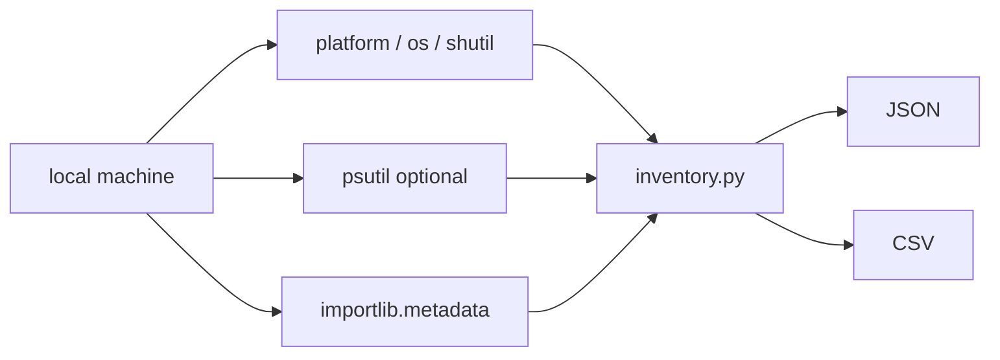

# System Inventory Collector

[](https://github.com/AJJudkins/system-inventory-collector/actions/workflows/ci.yml)

IT teams often need a quick, consistent snapshot of a machine. This tool collects OS, CPU, memory, disk and installed Python package details from the local machine and writes JSON or CSV. It performs no network activity.

> Portfolio project. Uses simulated/sample data only.

## Architecture



## Setup

```bash
git clone https://github.com/AJJudkins/system-inventory-collector.git
cd system-inventory-collector
# Python 3.9+. Optional, for physical cores and memory:
pip install -r requirements.txt
```

## Usage

```bash
python inventory.py                          # JSON to stdout
python inventory.py --format csv --output inventory.csv
python inventory.py --include-hostname
```

## Sample output

```text
key,value
os.system,Linux
os.release,6.12.94+
os.version,#1 SMP PREEMPT_DYNAMIC Fri Oct 16 00:53:04 UTC 2026
os.machine,x86_64
os.python,3.13.5
cpu.logical_cores,8
cpu.physical_cores,8
memory.total_gb,15.63
memory.available_gb,4.06
disk.path,/
disk.total_gb,124.99
disk.used_gb,6.56
...
```

## Tests

```bash
pip install -r requirements-dev.txt
pytest
```

## What this demonstrates

- Cross-platform system information with `platform`, `os`, `shutil`, `importlib.metadata`
- Optional dependency handling (psutil)
- Privacy-aware defaults: hostname is excluded unless requested, and nothing is sent anywhere (a test asserts no socket connections)
- JSON and CSV output

## Limitations

- The sample output above is from one Linux test machine; your values will differ.
- Memory and physical-core data need psutil; otherwise they are `null`/missing.
- Reports only the primary disk path, and only Python packages in the running interpreter's environment, not OS packages.
- Tested on Linux only; macOS and Windows should work but are untested.
- Not a replacement for an enterprise asset-management tool.

## Hardening notes
- `--no-packages` omits the installed Python package list (which can reveal software).
- `--output` creates the file owner-only (`0600`), and refuses to overwrite an existing file unless `--force` is given.
- Errors (for example an unwritable path) exit with code 2 and a clear message.
- Console script after `pip install -e .`: `system-inventory --no-packages`.

## Security and testing status

- **Safety:** local-only and read-only: no network connections, hostname excluded unless `--include-hostname`, `--no-packages` to omit software lists, output files are `0600` and never overwritten without `--force`.
- **Tested:** collection, JSON/CSV output and file-safety behavior on Linux (containers and CI).
- **Not tested:** Windows and macOS, systems without psutil in unusual environments, and any large fleet use; it inventories only the machine it runs on.
- See [SECURITY.md](SECURITY.md).

## License

MIT
